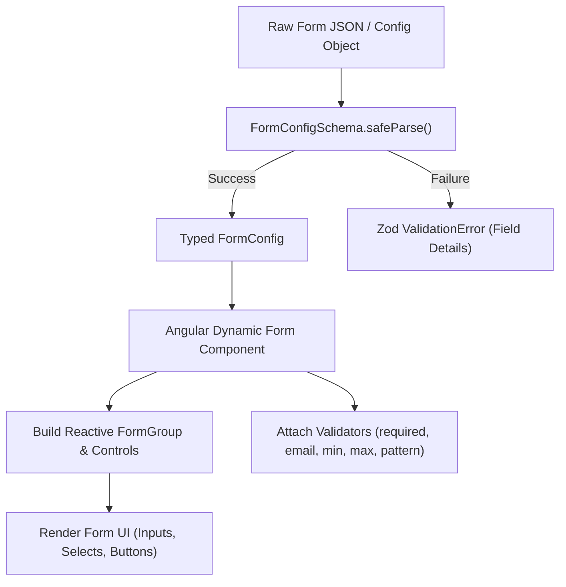

# Smart Form Schema Documentation

This document describes the schema architecture, data models, validation rules, and integration patterns for the form generation engine in **Smart Form Generator**.

The core implementation is defined in [`src/app/form-schema.ts`](file:///d:/learning/antigravity-ai/smart-form-generator/src/app/form-schema.ts) and re-exported via [`src/form-schema.ts`](file:///d:/learning/antigravity-ai/smart-form-generator/src/form-schema.ts).

---

## Table of Contents
1. [Overview & Architecture](#overview--architecture)
2. [Data Models & Zod Schemas](#data-models--zod-schemas)
   - [FormConfigSchema & FormConfig](#formconfigschema--formconfig)
   - [FormFieldSchema & FormField](#formfieldschema--formfield)
   - [FormFieldValidationSchema & FormFieldValidation](#formfieldvalidationschema--formfieldvalidation)
   - [Supported Field Types](#supported-field-types)
   - [Supported Validation Types](#supported-validation-types)
3. [Schema Validation with Zod](#schema-validation-with-zod)
4. [Sanitizing & Validating LLM Output](#sanitizing--validating-llm-output)
5. [Complete Sample Form Configuration](#complete-sample-form-configuration)
6. [Angular Dynamic Form Integration Guide](#angular-dynamic-form-integration-guide)

---

## Overview & Architecture

The Smart Form Generator utilizes [Zod](https://zod.dev/) for strict runtime validation and automatic TypeScript type inference. This guarantees that form configurations provided to the application are structurally sound and conform to expected rules before rendering.



---

## Data Models & Zod Schemas

All schemas and inferable types are exported from [`src/app/form-schema.ts`](file:///d:/learning/antigravity-ai/smart-form-generator/src/app/form-schema.ts).

### FormConfigSchema & FormConfig

The top-level configuration object defining the entire form.

```typescript
export const FormConfigSchema = z.object({
  formTitle: z.string().min(1, "Form title must be defined"),
  formDescription: z.string().optional(),
  submitButtonLabel: z.string().default('Submit'),
  fields: z.array(FormFieldSchema)
});

export type FormConfig = z.infer<typeof FormConfigSchema>;
```

#### Properties

| Property | Type | Required | Default | Description |
| :--- | :--- | :--- | :--- | :--- |
| `formTitle` | `string` | Yes | — | Title displayed at the top of the form (minimum 1 character). |
| `formDescription` | `string` | No | `undefined` | Optional subtitle or description text. |
| `submitButtonLabel` | `string` | No | `'Submit'` | Custom label for the primary submit button. |
| `fields` | `FormField[]` | Yes | — | Array of field definitions to render in order. |

---

### FormFieldSchema & FormField

Defines each individual form field, including its type, label, control name, options, and validations.

```typescript
export const FormFieldSchema = z.object({
  name: z.string().regex(/^[a-zA-Z0-9_]+$/, "Field name must be alphanumeric and contains no spaces"),
  label: z.string().min(1, "Field label cannot be empty"),
  type: z.enum(['text', 'number', 'email', 'password', 'select', 'textarea', 'checkbox']),
  placeholder: z.string().optional(),
  defaultValue: z.any().optional(),
  options: z.array(z.object({
    label: z.string(),
    value: z.any()
  })).optional().describe("Options required only when type is 'select'"),
  validations: z.array(FormFieldValidationSchema).optional()
});

export type FormField = z.infer<typeof FormFieldSchema>;
```

#### Properties

| Property | Type | Required | Description |
| :--- | :--- | :--- | :--- |
| `name` | `string` | Yes | Unique identifier / form control key. Must match `/^[a-zA-Z0-9_]+$/` (alphanumeric and underscores, no spaces). |
| `label` | `string` | Yes | Human-readable label displayed next to or above the field. |
| `type` | `FormFieldType` | Yes | The control input type. See [Supported Field Types](#supported-field-types). |
| `placeholder` | `string` | No | Placeholder text for input and textarea controls. |
| `defaultValue` | `any` | No | Initial value populated when the form initializes. |
| `options` | `Array<{ label: string; value: any }>` | Optional* | List of selection options. Required when `type` is `'select'`. |
| `validations` | `FormFieldValidation[]` | No | List of validation constraints applied to this field. |

---

### FormFieldValidationSchema & FormFieldValidation

Defines a single validation rule applied to a field.

```typescript
export const FormFieldValidationSchema = z.object({
  type: z.enum(['required', 'email', 'min', 'max', 'pattern']),
  value: z.any().optional(), // e.g., length number for min/max, string regex for pattern
  message: z.string().min(1, "Error message must be specified for field validation")
});

export type FormFieldValidation = z.infer<typeof FormFieldValidationSchema>;
```

#### Properties

| Property | Type | Required | Description |
| :--- | :--- | :--- | :--- |
| `type` | `'required' \| 'email' \| 'min' \| 'max' \| 'pattern'` | Yes | The validation rule type. |
| `value` | `any` | Optional | Parameter for the validation rule (e.g. numeric limit for `min`/`max`, regex string for `pattern`). |
| `message` | `string` | Yes | Custom error message to show when validation fails (must not be empty). |

---

### Supported Field Types

The `type` property of [`FormField`](file:///d:/learning/antigravity-ai/smart-form-generator/src/app/form-schema.ts#L31) accepts one of the following 7 values:

| Type | Description | HTML Equivalent | Notes |
| :--- | :--- | :--- | :--- |
| `'text'` | Single-line plain text input | `<input type="text">` | General-purpose text. |
| `'number'` | Numeric input | `<input type="number">` | Supports `min` and `max` validations. |
| `'email'` | Email input | `<input type="email">` | Standard email input with browser validation hints. |
| `'password'` | Masked password input | `<input type="password">` | Conceals user input. |
| `'select'` | Dropdown selection | `<select>` | Requires `options` array with `{ label, value }`. |
| `'textarea'` | Multi-line text area | `<textarea>` | For descriptions, notes, or long comments. |
| `'checkbox'` | Binary toggle / agreement | `<input type="checkbox">` | `defaultValue` is typically boolean (`true` / `false`). |

---

### Supported Validation Types

| Validation Type | Expected `value` | Description | Example Message |
| :--- | :--- | :--- | :--- |
| `'required'` | `undefined` or `boolean` | Ensures the field has a non-empty value. | `"This field is required"` |
| `'email'` | `undefined` or `boolean` | Verifies valid email address format. | `"Please enter a valid email address"` |
| `'min'` | `number` | Minimum character length for strings, or minimum numeric value for numbers. | `"Must be at least 18"` / `"Minimum 8 characters required"` |
| `'max'` | `number` | Maximum character length for strings, or maximum numeric value for numbers. | `"Cannot exceed 100"` / `"Maximum 250 characters allowed"` |
| `'pattern'` | `string` (regular expression) | Value must match the supplied regex string. | `"Password must contain at least one uppercase letter and one number"` |

---

## Schema Validation with Zod

You can validate incoming JSON or objects at runtime using [`FormConfigSchema`](file:///d:/learning/antigravity-ai/smart-form-generator/src/app/form-schema.ts#L22):

```typescript
import { FormConfigSchema, type FormConfig } from './form-schema';

const incomingJson: unknown = {
  formTitle: "User Registration",
  submitButtonLabel: "Create Account",
  fields: [
    {
      name: "username",
      label: "Username",
      type: "text",
      validations: [
        { type: "required", message: "Username is required" },
        { type: "min", value: 3, message: "Username must be at least 3 characters" }
      ]
    }
  ]
};

// Safe parsing: returns a discriminated union { success: true; data } or { success: false; error }
const parseResult = FormConfigSchema.safeParse(incomingJson);

if (parseResult.success) {
  const validConfig: FormConfig = parseResult.data;
  console.log("Loaded valid form:", validConfig.formTitle);
} else {
  console.error("Schema validation failed:", parseResult.error.format());
}
```

---

## Sanitizing & Validating LLM Output

When generating forms via AI models (e.g., Gemini, OpenAI), raw responses often contain markdown formatting (```` ```json ````), conversational preambles, trailing commas, or unsanitized script tags.

The [`sanitizeAndValidateLLMOutput`](file:///d:/learning/antigravity-ai/smart-form-generator/src/app/utils/llm-sanitizer.utils.ts) utility cleans, normalizes, and validates the output in a single call:

```typescript
import { sanitizeAndValidateLLMOutput, safeSanitizeAndValidateLLMOutput } from './form-schema';

const rawLLMResponse = `
Here is the requested registration form:
\`\`\`json
{
  "formTitle": "User Signup <script>alert('xss')</script>",
  "fields": [
    {
      "name": "first-name",
      "label": "First Name",
      "type": "string",
      "validations": [{ "type": "required" }]
    },
    {
      "name": "role",
      "label": "Role",
      "type": "dropdown",
      "options": ["Admin", "User", "Guest"]
    }
  ],
}
\`\`\`
`;

// 1. Direct parsing: returns typed FormConfig or throws LLMSanitizerError
const config = sanitizeAndValidateLLMOutput(rawLLMResponse);
console.log(config.formTitle); // "User Signup" (XSS tag sanitized)
console.log(config.fields[0].name); // "first_name" (hyphen converted to underscore)
console.log(config.fields[0].type); // "text" (normalized from 'string')
console.log(config.fields[1].type); // "select" (normalized from 'dropdown')

// 2. Safe parsing: returns discriminated union without throwing
const result = safeSanitizeAndValidateLLMOutput(rawLLMResponse);
if (result.success) {
  console.log("Valid configuration:", result.data);
} else {
  console.error("Sanitization error:", result.error);
}
```

### Sanitization Features

- **Markdown & Envelope Extraction**: Automatically extracts JSON from code fences and unwraps outer envelopes (`{ formConfig: { ... } }`, `{ data: { ... } }`).
- **Trailing Comma Repair**: Strips trailing commas that cause `JSON.parse` failures.
- **XSS & HTML Neutralization**: Strips `<script>`, `javascript:`, inline event handlers (`onload=`, `onerror=`), and raw HTML tags.
- **Field Name Normalization**: Converts spaces and hyphens to underscores (`/^[a-zA-Z0-9_]+$/`).
- **Field Type Aliases**: Automatically maps common AI aliases (e.g. `dropdown` -> `select`, `multiline` -> `textarea`, `bool` -> `checkbox`, `string` -> `text`).
- **Options Normalization**: Converts arrays of strings into `{ label, value }` pairs for `select` fields.
- **Validation Fallback Messages**: Auto-generates friendly validation error messages if the model omitted them.

---

## Complete Sample Form Configuration

Here is a full example illustrating every field type and validation rule:

```typescript
import { FormConfig } from './form-schema';

export const USER_REGISTRATION_CONFIG: FormConfig = {
  formTitle: 'User Registration',
  formDescription: 'Create a new account by filling in your information below.',
  submitButtonLabel: 'Register Now',
  fields: [
    {
      name: 'full_name',
      label: 'Full Name',
      type: 'text',
      placeholder: 'Jane Doe',
      validations: [
        { type: 'required', message: 'Full name is required' },
        { type: 'min', value: 2, message: 'Name must have at least 2 characters' }
      ]
    },
    {
      name: 'email_address',
      label: 'Email Address',
      type: 'email',
      placeholder: 'jane.doe@example.com',
      validations: [
        { type: 'required', message: 'Email address is required' },
        { type: 'email', message: 'Please enter a valid email address' }
      ]
    },
    {
      name: 'password',
      label: 'Password',
      type: 'password',
      placeholder: '••••••••',
      validations: [
        { type: 'required', message: 'Password is required' },
        { type: 'min', value: 8, message: 'Password must be at least 8 characters long' },
        { type: 'pattern', value: '^(?=.*[A-Za-z])(?=.*\\d).+$', message: 'Password must contain at least one letter and one number' }
      ]
    },
    {
      name: 'age',
      label: 'Age',
      type: 'number',
      placeholder: '25',
      validations: [
        { type: 'min', value: 18, message: 'You must be at least 18 years old' },
        { type: 'max', value: 120, message: 'Please enter a realistic age' }
      ]
    },
    {
      name: 'role',
      label: 'Select Role',
      type: 'select',
      defaultValue: 'developer',
      options: [
        { label: 'Developer', value: 'developer' },
        { label: 'Designer', value: 'designer' },
        { label: 'Product Manager', value: 'manager' }
      ],
      validations: [
        { type: 'required', message: 'Please select a role' }
      ]
    },
    {
      name: 'bio',
      label: 'Short Bio',
      type: 'textarea',
      placeholder: 'Tell us a little bit about yourself...',
      defaultValue: '',
      validations: [
        { type: 'max', value: 300, message: 'Bio cannot exceed 300 characters' }
      ]
    },
    {
      name: 'terms_agreed',
      label: 'I agree to the Terms of Service and Privacy Policy',
      type: 'checkbox',
      defaultValue: false,
      validations: [
        { type: 'required', message: 'You must accept the terms and conditions' }
      ]
    }
  ]
};
```

---

## Angular Dynamic Form Integration Guide

This example shows how to dynamically initialize an Angular `FormGroup` from a [`FormConfig`](file:///d:/learning/antigravity-ai/smart-form-generator/src/app/form-schema.ts#L30) and wire up Angular `Validators`.

```typescript
import { Component, OnInit, signal } from '@angular/core';
import {
  FormControl,
  FormGroup,
  ReactiveFormsModule,
  ValidatorFn,
  Validators
} from '@angular/forms';
import {
  FormConfig,
  FormField,
  FormFieldValidation,
  FormConfigSchema
} from './form-schema';

@Component({
  selector: 'app-dynamic-form',
  imports: [ReactiveFormsModule],
  template: `
    <div class="form-container">
      <h2>{{ config.formTitle }}</h2>
      @if (config.formDescription) {
        <p class="description">{{ config.formDescription }}</p>
      }

      <form [formGroup]="form" (ngSubmit)="onSubmit()">
        @for (field of config.fields; track field.name) {
          <div class="field-group">
            <label [for]="field.name">{{ field.label }}</label>

            @switch (field.type) {
              @case ('textarea') {
                <textarea
                  [id]="field.name"
                  [formControlName]="field.name"
                  [placeholder]="field.placeholder ?? ''"
                ></textarea>
              }
              @case ('select') {
                <select [id]="field.name" [formControlName]="field.name">
                  <option value="" disabled>Select an option</option>
                  @for (opt of field.options ?? []; track opt.value) {
                    <option [value]="opt.value">{{ opt.label }}</option>
                  }
                </select>
              }
              @case ('checkbox') {
                <div class="checkbox-wrapper">
                  <input
                    type="checkbox"
                    [id]="field.name"
                    [formControlName]="field.name"
                  />
                  <span>{{ field.label }}</span>
                </div>
              }
              @default {
                <input
                  [type]="field.type"
                  [id]="field.name"
                  [formControlName]="field.name"
                  [placeholder]="field.placeholder ?? ''"
                />
              }
            }

            @if (form.get(field.name)?.invalid && (form.get(field.name)?.touched || submitted())) {
              <div class="error-message">
                {{ getFieldError(field) }}
              </div>
            }
          </div>
        }

        <button type="submit">{{ config.submitButtonLabel }}</button>
      </form>
    </div>
  `
})
export class DynamicFormComponent implements OnInit {
  // Input or defined configuration
  config: FormConfig = {
    formTitle: 'Contact Us',
    submitButtonLabel: 'Send Message',
    fields: [
      {
        name: 'sender_name',
        label: 'Your Name',
        type: 'text',
        placeholder: 'John Doe',
        validations: [{ type: 'required', message: 'Name is required' }]
      },
      {
        name: 'sender_email',
        label: 'Your Email',
        type: 'email',
        placeholder: 'john@example.com',
        validations: [
          { type: 'required', message: 'Email is required' },
          { type: 'email', message: 'Invalid email address' }
        ]
      },
      {
        name: 'message_text',
        label: 'Message',
        type: 'textarea',
        placeholder: 'Write your message here...',
        validations: [{ type: 'required', message: 'Message cannot be empty' }]
      }
    ]
  };

  form = new FormGroup({});
  submitted = signal(false);

  ngOnInit() {
    this.buildForm();
  }

  buildForm() {
    for (const field of this.config.fields) {
      const initialValue = field.defaultValue ?? (field.type === 'checkbox' ? false : '');
      const validators = this.mapValidations(field);
      this.form.addControl(field.name, new FormControl(initialValue, validators));
    }
  }

  mapValidations(field: FormField): ValidatorFn[] {
    const fns: ValidatorFn[] = [];
    if (!field.validations) return fns;

    for (const rule of field.validations) {
      switch (rule.type) {
        case 'required':
          fns.push(field.type === 'checkbox' ? Validators.requiredTrue : Validators.required);
          break;
        case 'email':
          fns.push(Validators.email);
          break;
        case 'min':
          if (field.type === 'number') {
            fns.push(Validators.min(rule.value));
          } else {
            fns.push(Validators.minLength(rule.value));
          }
          break;
        case 'max':
          if (field.type === 'number') {
            fns.push(Validators.max(rule.value));
          } else {
            fns.push(Validators.maxLength(rule.value));
          }
          break;
        case 'pattern':
          fns.push(Validators.pattern(rule.value));
          break;
      }
    }

    return fns;
  }

  getFieldError(field: FormField): string {
    const control = this.form.get(field.name);
    if (!control || !control.errors || !field.validations) return '';

    for (const rule of field.validations) {
      if (rule.type === 'required' && control.hasError('required')) return rule.message;
      if (rule.type === 'email' && control.hasError('email')) return rule.message;
      if (rule.type === 'min' && (control.hasError('min') || control.hasError('minlength'))) return rule.message;
      if (rule.type === 'max' && (control.hasError('max') || control.hasError('maxlength'))) return rule.message;
      if (rule.type === 'pattern' && control.hasError('pattern')) return rule.message;
    }

    return 'Invalid field value';
  }

  onSubmit() {
    this.submitted.set(true);
    if (this.form.invalid) {
      this.form.markAllAsTouched();
      return;
    }

    console.log('Form data:', this.form.value);
  }
}
```
